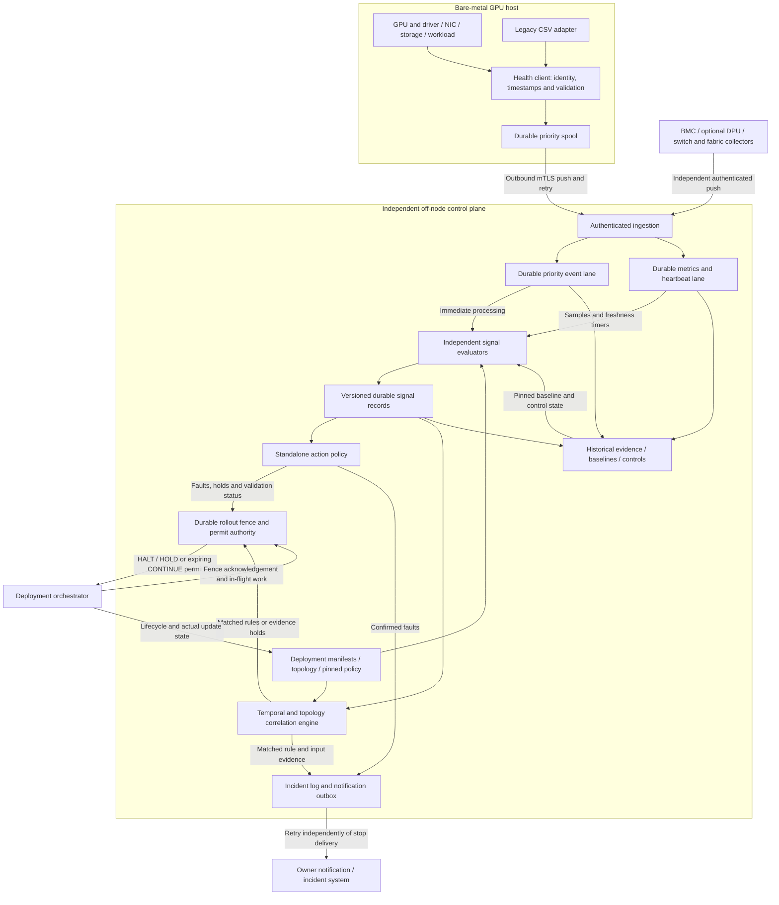
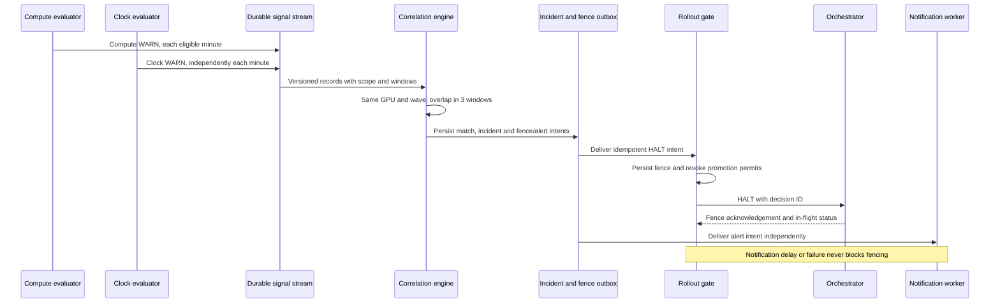

# Architecture: GPU Health Signals, Correlation, and Rollout Safety

## 1. Scope and design boundaries

This is the dedicated architecture design for the proposed GPU update-safety service. It describes a feature specification, not an implemented runtime.

- [Signal catalog and definitions](README.md#4-named-health-signal-contract) are the source of truth for signal IDs and thresholds.
- [Correlation rule catalog](README.md#correlation-rules) is the source of truth for cross-signal stop conditions.
- [Rollout state machine](README.md#7-rollout-state-machine-and-enforcement) defines deployment phases, containment, recovery and promotion.

**Core invariant:** signals are independently useful and independently emitted. Only the correlation engine combines their verdicts. A critical standalone fault must not wait for a correlation match, another node's report, or a trend window.

The host runs a generic health client for collection, normalization and durable publishing. The authoritative evaluation and rollout gate run off-node, outside the candidate rollout's failure domain. Optional DPU/BMC/fabric collectors provide independent evidence; they cannot replace host CUDA/runtime or workload visibility.

## 2. Component and deployment diagram



In plain text: **raw evidence -> independently evaluated signals -> standalone policy and correlation rules -> incidents plus rollout fences**.

Signals are durably published before downstream consumption. A hard-fault consumer uses a priority lane and does not wait behind windowed diagnostics. Replicated durable state and a single fenced authority per deployment scope prevent conflicting promotion permits during failover.

## 3. Signal evaluation and ownership

Each evaluator consumes raw observations, its own state, and versioned context such as baseline, test configuration and topology. It does **not** consume another evaluator's signal verdict.

For example:

- The compute evaluator reports `GPU_COMPUTE_REGRESSION = WARN` from its matched throughput comparison, regardless of clock or thermal state.
- The clock evaluator separately reports `GPU_CLOCK_ABNORMAL = WARN` from active-clock evidence.
- The correlation engine matches `HALT_COMPUTE_WITH_GPU_WARNING` when both overlap for the required three windows on the same GPU/dependency scope.
- An uncorrectable-memory evaluator reports `GPU_UNCORRECTABLE_MEMORY_ERROR = FAIL`, and standalone policy immediately requests alerting and halting without consulting either evaluator above.

Signal records retain `signal_id`, `definition_version`, `state`, entity/scope, deployment ID/wave, policy version, evaluation-window start/end, workload/test context, baseline/control identity, quality, and evidence IDs. Assign stable signal-record IDs for references and deduplication.

The independence guarantee concerns signal verdicts, not redundant collection: evaluators can reuse normalized raw telemetry. Independence also does not establish causality; a clock warning and compute regression justify stopping exposure without proving the update caused either.

Applicability and supported definition versions are resolved at precheck. Signal definition version 2 separates symptoms from earlier composite draft verdicts. Incompatible records cannot be silently accepted by a rule.

## 4. Near-real-time delivery

1. Capture authoritative critical events as emitted. Sample fast metrics and heartbeats every five seconds.
2. Persist locally; send critical events immediately and flush collected metric batches at most once per second. CSV is a compatibility snapshot path, not the sole urgent-event mechanism.
3. Use an outbound authenticated connection, producer identity/epoch/sequence, stable event ID, bounded retries and at-least-once delivery.
4. Acknowledge ingestion only after replicated stream acceptance. A client retires its spool entry only after that acknowledgement.
5. Prioritize urgent evidence and hard signal records. Publish each windowed symptom as soon as its evidence window is eligible, without waiting for corroboration.
6. The correlation engine joins signal records by event time, deployment context and dependency scope. Persist a match and an idempotent fence request durably before acknowledging match processing.
7. The rollout gate persists/revokes permits and delivers the fence until the orchestrator acknowledges it. Alert delivery uses an independent durable outbox and cannot block fencing.

Design targets, to be measured end to end:

- Critical source event to orchestrator fence acknowledgement: p99 <=10 seconds.
- Polled hard-state detection to fence: p99 <=20 seconds, including sampling.
- Windowed correlation: three eligible one-minute windows plus bounded late-data handling; target <=5 minutes after sustained degradation begins when comparable work is available.
- Host heartbeat older than 15 seconds or required fast observation older than 20 seconds blocks promotion.

No system can deliver host events in real time across a disconnected network. Outages therefore block new promotion permits, preserve replay where possible, and use independent observations. A local spool does not survive every host/disk failure.

## 5. Correlation and alert lifecycle

### Rule representation

The following is a declarative contract example, not executable configuration shipped with this repository. Thresholds belong to the independent signal definitions; the rule refers only to their versioned states.

```json
{
  "rule_id": "HALT_COMPUTE_WITH_GPU_WARNING",
  "rule_version": 1,
  "accepted_signal_definition_version": 2,
  "join": {
    "same": ["deployment_id", "wave", "policy_version", "workload_context"],
    "scope": "same_gpu_or_verified_dependency_path",
    "topology_version": "pinned_for_wave"
  },
  "when": {
    "all": [
      {"signal_id": "GPU_COMPUTE_REGRESSION", "state": "WARN"},
      {
        "any": [
          {"signal_id": "GPU_THROTTLING_ABNORMAL", "state": "WARN"},
          {"signal_id": "GPU_CLOCK_ABNORMAL", "state": "WARN"},
          {"signal_id": "GPU_MEMORY_WARNING", "state": "WARN"}
        ]
      }
    ]
  },
  "persistence": {
    "window_seconds": 60,
    "consecutive_windows": 3,
    "allowed_lateness_seconds": 30
  },
  "on_match": ["PERSIST_INCIDENT", "FENCE_ACTIVE_WAVE", "NOTIFY_OWNER"],
  "resume": "AUDITED_APPROVAL_AND_REVALIDATION"
}
```

Use the [full rule catalog](README.md#correlation-rules) for compute, HBM, local/cluster fabric, storage, memory and host-contention combinations. Do not define a rule as merely "any two abnormal signals."

### Event time, topology and missing data

- Use aligned one-minute event-time windows. Require overlapping evidence in each of three consecutive eligible windows, not just timestamps falling somewhere in the same three-minute interval.
- Initially allow 30 seconds for late window records. This is a proposed policy default, not a sensor guarantee. A rule can match as soon as all three windows have sufficient finalized abnormal evidence; a missing window cannot be skipped.
- Admit amendments within the allowed lateness and store record revisions; evaluate the latest compatible revision, not old and new copies as separate evidence. Historical records beyond that bound remain investigation evidence. Unexpected late required data is a coverage fault that blocks promotion; do not silently drop it and claim healthy.
- Late hard-fault events still trigger incident assessment, including for a completed deployment. For an active candidate wave, persist the applicable fence; for completed deployments, alert and assess the current release rather than issue a permit based on history.
- Detect source clock skew and reject incomparable timing into explicit data-quality state. Use receiver timers for heartbeat expiry.
- `UNKNOWN` cannot satisfy an abnormal predicate. Use three-valued AND/OR evaluation as defined in the README. A proven-normal optional branch can make a conjunction false without erasing a separate required-evidence hold.
- Never correlate unrelated GPU-A/GPU-B warnings, different policy versions, workloads, boot/reset epochs with incompatible evidence, or different waves. Cross-entity joins require a pinned dependency mapping, such as a collective's participants and NIC rail.

### Incident, fence and notification

A matched rule creates a **correlation result**, not a new health signal:

```json
{
  "kind": "health.correlation",
  "match_id": "match-042-compute-gpu-a-001",
  "rule_id": "HALT_COMPUTE_WITH_GPU_WARNING",
  "rule_version": 1,
  "state": "MATCHED",
  "deployment_id": "deploy-042",
  "wave": "canary",
  "scope": {"type": "gpu", "id": "GPU-A"},
  "window_start": "2026-11-16T21:00:00Z",
  "window_end": "2026-11-16T21:03:00Z",
  "policy_version": "gpu-gate-v2",
  "input_signal_record_ids": [
    "compute-a-minute-1", "clock-a-minute-1",
    "compute-a-minute-2", "clock-a-minute-2",
    "compute-a-minute-3", "clock-a-minute-3"
  ],
  "incident_id": "incident-042-001",
  "requested_action": "HALT"
}
```

- Store the rule version, qualifying inputs per window, topology mapping, baseline/control provenance and reason. A viewer must show the independent X and Y records, not just "GPU unhealthy."
- Deduplicate matches by deployment, wave, rule version, joined scope and fault episode. Group related rules into one incident only when they share an evidenced dependency/fault episode; retain every rule match and do not collapse unrelated failures merely because they occur in one wave.
- Persist incident and fence intents atomically in one transaction, or use a durable outbox so a crash cannot leave a processed match without a fence. Deliver fence and notification independently with idempotent IDs, retries and acknowledgement tracking.
- Send one initial critical notification; update it with new evidence and escalate if unacknowledged according to the owner policy. Alert acknowledgements and orchestrator fence acknowledgements are different.
- An alert delivery failure must never cancel a halt. A fence delivery failure raises `ROLLOUT_FENCE_UNACKNOWLEDGED`, revokes promotion and escalates while delivery retries continue.
- When inputs recover, mark the incident's observations recovered but keep the halt latched. Audited approval plus revalidation is required to resume.

## 6. Correlation sequence diagram



Standalone hard failures bypass the correlation wait entirely. An unmatched performance symptom still holds promotion for retesting; supporting warnings alone are advisory.

## 7. Availability, replay and acceptance

- Checkpoint window/rule state and deduplication cursors. Fence one decision authority per deployment scope; a stale consumer must not issue a fresh permit after failover.
- Preserve producer and device counter epochs across reboot/reset. Never interpret a negative counter delta or missing observation as a healthy zero.
- Missing required data, incompatible schema, full/corrupt spool or processing backlog causes a visible evidence hold. Reserve critical/heartbeat capacity rather than silently dropping urgent events.
- Pin policy, baselines, controls and topology for each wave. Audit any approved change; never mix records from different rule versions to satisfy a persistence requirement.
- Test X-only, Y-only, X+Y same scope, X+Y unrelated scope, insufficient overlap, unknown/stale inputs, reset epochs, duplicate/reordered records, late amendments, and hard faults bypassing rules.
- Test crash points between match, incident, fence and notification persistence; verify retries cannot lose a halt or generate duplicate incident storms.
- Validate measured source-to-fence and symptom-to-match latency, not just successful ingestion. Keep a halted release halted through replay, observer recovery and alert acknowledgement until explicitly resumed.
