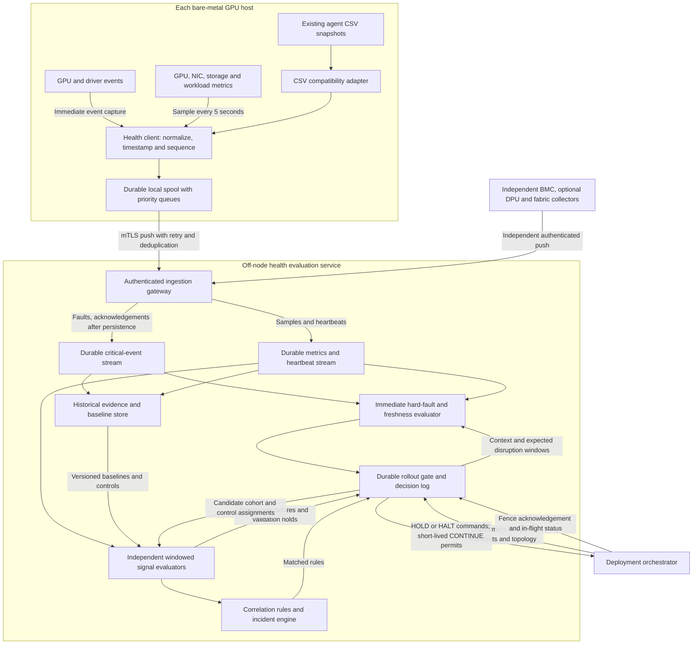
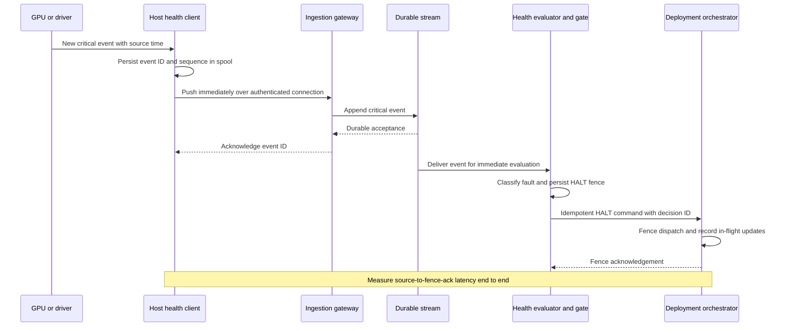

# GPU Node Health Gates for Agent and Firmware Updates

**Design documents:** [Architecture and near-real-time signal delivery](ARCHITECTURE.md), including the independent signal evaluators, correlation/alert engine, and rollout control flow. This README owns the signal catalog and rollout policy.

## 1. Purpose and recommendation

Build a deployment safety service that answers:

> Did this update make GPU nodes, their communication fabric, or their data path unhealthy enough that we must stop the rollout?

The service compares pre-update and post-update evidence, checks absolute safety limits, and evaluates the updated nodes against unchanged controls. It sends a durable decision to the deployment orchestrator, which must enforce that decision before updating more nodes.

**Recommended design:**

- Keep a lightweight health client on each bare-metal host for direct GPU, driver, runtime, network, and storage visibility.
- Send observations and urgent events to an independent, off-node health evaluation service. Do not rely on the updated node to approve its own rollout.
- Add BMC and optional SoC/DPU observations as independent sources, not replacements for host telemetry.
- Stop on a single confirmed critical fault. For softer symptoms, require sustained regression plus corroboration, or a strong independently repeated end-to-end regression.
- Treat missing telemetry as `UNKNOWN`, never healthy. Hold promotion when required evidence is missing.
- Make the deployment unit topology-aware: GPU, node, distributed job, fabric partition, rack, and cluster are different failure scopes.
- Do not reduce the decision to one weighted health score. A good temperature must never cancel out an uncorrectable memory error.

This README is a proposed design, not an implemented service. Numeric thresholds below are initial policy candidates, **not NVIDIA or Azure guarantees**. Calibrate them in shadow mode for each hardware, firmware, workload, and network profile.

### Assumptions and terminology

- The initial target is Linux bare-metal NVIDIA GPU infrastructure, using Kubernetes or a comparable scheduler. Adapt the collectors and vendor-specific policies for AMD or other accelerators.
- "Health client" and "health evaluation service" are generic architectural roles, not specific products. Existing client APIs, privileges, and delivery guarantees must be verified before integration.
- "SoC" is assumed to mean an independently running management processor or SmartNIC/DPU, such as a BlueField Arm subsystem, **not a security operations center**. Confirm this meaning before implementation.
- BMC is a management controller with firmware and out-of-band interfaces, not simply another host process.
- Host agent, NMAgent, and "NICE agent" are treated as examples from your environment. There is no assumed one-to-one mapping to a universal bare-metal GPU agent inventory.
- A node health failure is not proof the update caused it. Stop exposure first when necessary; determine attribution separately.

## 2. What gets updated on a GPU bare-metal node?

A bare-metal GPU server has the usual host-management stack **plus** GPU, high-speed fabric, and GPU-aware storage components. Inventory the actual installed services and firmware rather than relying on these example names.

| Layer | Common components or update targets | Main failure modes to gate |
|---|---|---|
| Provisioning and host management | Image/provisioning agent, lifecycle/configuration agent, security agent, telemetry client, certificate/configuration packages | Reboot loops, permission changes, CPU overhead, missing telemetry, broken device access |
| OS and platform | Kernel, GPU kernel modules, initramfs, BIOS/UEFI, CPU microcode, PCIe/IOMMU/NUMA settings | Driver incompatibility, PCIe errors, peer-to-peer path changes, placement regressions |
| GPU driver and firmware | NVIDIA driver, NVML, GSP firmware where applicable, device VBIOS/firmware through supported tooling | Missing GPUs, initialization/reset failures, errors, clock or performance changes |
| GPU fabric management | NVIDIA Fabric Manager on applicable NVSwitch systems; NVLink Subnet Manager (NVLSM) where required by the platform; NVSwitch firmware | Fabric not initialized, missing links, partition mismatch, failed collectives |
| Runtime and scheduler integration | Container runtime, NVIDIA Container Toolkit, Kubernetes device plugin, GPU Feature Discovery, MIG Manager where used; kubelet or Slurm components | GPUs visible to the host but unavailable to jobs; wrong resources or MIG layout |
| GPU monitoring and diagnostics | DCGM host engine, DCGM Exporter, health/diagnostic configuration | Missing fields, changed units, stale samples, observer-induced overhead |
| Host networking and RDMA | NIC driver/firmware, inbox RDMA or supported vendor stack, rdma-core, networking agents/CNI, Network Operator where used | RDMA failure, link downshift, retransmission, wrong routing or QoS |
| Fabric control plane | InfiniBand subnet management/UFM or Ethernet/RoCE switch OS, routing, QoS, ECN/PFC configuration | Shared congestion, partition/routing errors, multi-node communication failures |
| Optional SoC/DPU | DPU OS/BSP, DOCA components, virtual switch/offload/network services, DPU firmware and telemetry | Offload/routing failure, data-path stalls, host/DPU compatibility mismatch |
| Storage | NVMe firmware, storage initiator/client, filesystem modules, CSI components, GPUDirect Storage/cuFile and nvidia-fs where applicable | I/O stalls, read failures, CPU bounce-path fallback, checkpoint failures |
| Out-of-band hardware management | BMC firmware, sensor configuration, platform management bundles, retimer/CPLD firmware where applicable | Loss of management, power/cooling problems, PCIe training issues |
| Workload software | CUDA user-space libraries, NCCL, framework/container images, communication plugins | ABI incompatibility, collective hangs, numerical or performance regression |

Not all rows are "agents." Some are firmware, libraries, scheduler integrations, or shared fabric services. The same deployment gate should support all of them, but their drain, test, rollback, and failure-domain policies differ. GPU Operator manages several Kubernetes GPU components; it is not the management plane for every row [3].

Record a **version/configuration manifest** before and after each update: host image/kernel, target agent, driver, GPU firmware, Fabric Manager/NVLSM, NIC firmware/driver, DPU, storage client, CUDA/NCCL, runtime, GPU/MIG topology, power caps, and relevant fabric configuration. Include artifact digests and configuration hashes. Avoid changing multiple unrelated layers in one canary.

## 3. Health model: four independent dimensions

Evaluate these independently for each entity and aggregate without averaging away failures:

1. **Correctness and safety:** Can computations and I/O complete correctly without unrecoverable faults?
2. **Availability and topology:** Are all expected GPUs, links, ports, partitions, and runtime resources usable?
3. **Performance:** Does comparable work complete at an acceptable rate and latency?
4. **Observability:** Is the evidence fresh, complete, and trustworthy enough to decide?

Expose `PASS`, `WARN`, `FAIL`, and `UNKNOWN` for each dimension and domain. A final deployment decision is separate: `CONTINUE`, `HOLD`, or `HALT`.

- `CONTINUE`: all required gates pass and minimum observation/test coverage is complete.
- `HOLD`: insufficient evidence, ambiguous regression, or a potentially shared incident. Do not promote.
- `HALT`: a confirmed critical fault or qualifying regression. Fence further rollout and contain the affected scope.

An idle GPU can be healthy but unvalidated for performance. A node with no errors and no telemetry is not healthy.

## 4. Named health-signal contract

These are the **health signals this service will produce**, not a list of things an operator could measure. Signal IDs are stable API identifiers owned by this design; they are not vendor metric names. Raw metrics/events are evidence used to compute a signal.

Every signal is evaluated and published **independently** from its own raw evidence, with its own identity, state, window, and explanation. No signal evaluator waits for or reads another signal's verdict. Combining signals is a separate correlation-rule feature, not a hidden dependency inside a signal.

There are three decision classes:

- **Critical, standalone:** any one confirmed `FAIL` stops the active rollout wave. No second signal is needed.
- **Independent primary symptoms:** a performance/deterioration signal reports its own abnormal condition. A separately named correlation rule decides whether it and another signal together justify stopping.
- **Good-to-have, supporting:** abnormal context explains a regression but never independently halts deployment. Absence of optional context must not disable repeated end-to-end regression detection.

Observability signals separately **hold promotion** when the service cannot make a safe decision. They do not label an unobserved GPU as defective.

### 4.1 Common evaluation contract

- Every signal carries `signal_id`, `definition_version`, `state`, entity/scope, deployment ID, evaluation window, source/evidence IDs, policy version, baseline ID when relevant, and a reason. Raw numeric values retain units and collection quality.
- This revision uses definition version 2 for the independent-signal contract. Earlier draft composite verdicts are not interchangeable with version-2 symptom records; consumers and rules pin supported definition versions. Correlation results use `rule_id`, not a fabricated merged `signal_id`.
- `PASS` means sufficient current evidence satisfies the definition; `WARN` means a noncritical anomaly or unconfirmed primary regression; `FAIL` means the catalog's failure predicate is satisfied; `UNKNOWN` means required evidence is absent, stale, invalid, or incomparable.
- For supporting signals, `WARN` means their anomaly predicate is true. They never emit a deployment-stopping `FAIL` merely because an explanatory metric is abnormal.
- Applicability is an explicit profile field, not a healthy default: for example, no NVSwitch/GDS signal is required on a platform without that feature. Report excluded signals with the exclusion reason. Missing evidence for an applicable mandatory signal is `UNKNOWN`.
- `R` is the update profile's **recovery deadline**, measured from the recorded start of the permitted disruption. Outside a permitted disruption, use a separately configured bounded confirmation timeout. During planned disruption, unavailable resources remain unvalidated and promotion stays blocked.
- A transient probe failure needs one bounded retry on reserved resources with a known-good reference endpoint where applicable. A verified integrity fault, authoritative fatal event, or platform-critical alarm does not wait for a retry.
- All performance drops/rises below are control-adjusted, beyond baseline noise, and based on comparable work as defined in section 5. Primary/supporting symptoms emit independently for each eligible one-minute window; the correlation layer applies the three-window persistence requirement. Explicit standalone repeated-test/SLO signals have their own confirmation rules.
- Warning thresholds, timeouts, supported capabilities, mandatory sources, and p99 sample requirements are explicit versioned profile parameters. Reject an incomplete profile at precheck with `HEALTH_EVIDENCE_INCOMPLETE`; do not invent universal vendor limits or silently skip a rule.

Emit per GPU UUID/MIG instance, required link/rail/path, node, or communication group as appropriate. A failed entity cannot be hidden by averaging healthy peers. Use the same ID before and after deployment; policy and evidence determine the state.

### 4.2 Critical standalone signals: one failure stops deployment

The last column defines `FAIL -> ALERT + HALT`: persist the incident/fence, notify the owner and deliver the stop command independently. Preserve the affected entity and dependency group even when the rollout fence covers the whole active wave.

| Signal ID | Definition: when this signal fails | Why it matters | Decision timing and scope |
|---|---|---|---|
| `GPU_DEVICE_UNAVAILABLE` | At least one GPU UUID or required MIG instance in the approved inventory is absent or unresponsive, or its expected scheduler resource is missing after device discovery completes. Evidence distinguishes a confirmed missing device from a failed collector. | A node can be `Ready` while usable GPU capacity has disappeared. | Fail after `R` during recovery, or bounded confirmation outside maintenance; scope is GPU/instance and node. |
| `GPU_EXECUTION_FAILED` | A reserved probe in the actual workload runtime cannot create a CUDA context, allocate its fixed test buffer, or complete its known kernel before the profile timeout on a required GPU, including the bounded retry. | Host visibility does not prove that containers/jobs can use the GPU; catches permissions, driver/runtime and initialization failures. | Fail after the retry and applicable recovery allowance; GPU/runtime scope. Customer application OOM is not this signal. |
| `GPU_UNCORRECTABLE_MEMORY_ERROR` | At least one new uncorrectable GPU memory error is established by an authoritative event or a positive counter delta within the same device/counter epoch. | Computation may be lost or unsafe; waiting for a throughput decline adds no useful protection. | Fail immediately on confirmation; GPU scope. An old lifetime total alone does not fail. |
| `GPU_MEMORY_REPAIR_FAILED` | The GPU reports row-remapping failure or a vendor-defined memory repair/spare-exhaustion state that requires taking it out of service. | Memory fault containment can no longer be trusted. | Fail immediately on authoritative state; GPU scope. A successful historical remap or pending maintenance alone is not failure. |
| `GPU_FATAL_FAULT` | A current Xid/SXid, recovery-action state, fatal PCIe/AER event, or equivalent platform event is classified by the versioned platform policy as unrecoverable or requiring isolation/reset of a required resource. | A seemingly live GPU/fabric may not safely execute further work without recovery. | Fail immediately outside declared reset activity; expected reset events are evaluated against recovery completion. GPU, node or fabric-partition scope [4]. |
| `GPU_RESULT_INCORRECT` | A deterministic compute/memory/collective correctness probe returns a value outside its fixed numerical tolerance or a mismatched exact checksum. The expected result, seed, precision and tolerance are part of the probe version. | Silent wrong answers are worse than visible slowdown and can occur with clean utilization/error counters. | Fail immediately on a verified mismatch; no second performance signal or retry is required. |
| `GPU_FABRIC_UNAVAILABLE` | The required NVLink/NVSwitch topology or partition differs from the approved topology, or required fabric initialization is not successful, making a mandatory GPU-to-GPU route unavailable. | Individual GPUs can pass local compute tests while the server's collective fabric is unusable. | Fail after `R` or bounded confirmation outside maintenance; GPU fabric/partition scope. Intentionally disabled links are excluded. |
| `GPU_COLLECTIVE_FAILED` | A required reserved intra-node or inter-node collective fails to complete within its profile timeout after the bounded retry against a validated group. | A failed rank/link can hang the complete distributed job despite healthy individual nodes. | Fail once confirmed and outside the allowed disruption; communication-group scope. Incorrect output instead triggers `GPU_RESULT_INCORRECT`. |
| `RDMA_PATH_UNAVAILABLE` | A mandatory NIC rail is down, a required RDMA/GPU-direct transfer fails after retry, or a workload requiring that transport demonstrably falls back to a disallowed transport. | Basic IP reachability cannot establish the data path needed for distributed GPU jobs. | Fail after `R` or bounded confirmation; rail/path/group scope. Reduced but still allowed bandwidth is a regression, not this signal. |
| `STORAGE_PATH_UNAVAILABLE` | A mandatory dataset/checkpoint path cannot complete its bounded read/write/restore operation after retry; an uncorrectable I/O error prevents a required operation; or a profile-required direct-storage path is unavailable/disallowed fallback is confirmed. | Jobs cannot feed GPUs or recover safely if their data/checkpoint path is broken. | Fail after applicable recovery/operation timeout; volume/path/node or shared-storage scope. Only use dedicated test artifacts. |
| `STORAGE_DATA_INTEGRITY_FAILED` | A known input block or dedicated checkpoint artifact fails its expected checksum or verified restore-content comparison. | Fast I/O is not healthy I/O if training data or recovery state is corrupted. | Fail immediately on verified mismatch; data-path scope. A slow restore without content failure is evaluated separately. |
| `PLATFORM_SAFETY_CRITICAL` | An authoritative OEM/platform sensor or event declares critical thermal, cooling, power-delivery, PSU or hardware safety failure. | Continuing a rollout during platform distress increases outage risk and confounds all performance evidence. | Fail immediately; affected node/rack scope. Ordinary temperature rise or expected power capping does not qualify. |
| `NODE_RECOVERY_FAILED` | A node does not return and satisfy its required host, driver, runtime, scheduler and fabric readiness checks before `R`. | A rollout must not continue replacing capacity when earlier nodes cannot recover. | Fail at the deadline; node and inseparable job-group scope. Observer loss alone first uses the observability hold signals below. |

### 4.3 Independent performance and deterioration signals

The first seven signals emit `WARN` when their own predicate is true in an eligible window, even if every supporting signal is healthy or absent. They do not consume other signals. An unmatched performance warning holds promotion for retest; an isolated correctable-ECC-rate warning is advisory unless its profile sets an additional maintenance gate. Shared degradation of controls holds evaluation pending incident investigation.

| Signal ID | Independent abnormal-condition definition | Independent state/action | Why it matters |
|---|---|---|---|
| `GPU_COMPUTE_REGRESSION` | Fixed compute-probe throughput falls >10%. Precision, shapes, power policy and placement are unchanged. | `WARN`; emit without waiting for clock, thermal or memory evidence. | Detects lost useful compute despite GPUs remaining visible and responsive. |
| `GPU_HBM_BANDWIDTH_REGRESSION` | Fixed GPU-memory probe's effective HBM bandwidth falls >10% at the same working set and access pattern. | `WARN`; emit independently of memory warnings. | Memory-bound jobs can regress while compute-only tests still pass. |
| `GPU_LOCAL_FABRIC_REGRESSION` | Intra-node collective bandwidth falls >15% OR p99 duration rises >20%, for the same group/message size and algorithm. | `WARN`; emit independently of link-error counters. | Detects degraded GPU-to-GPU communication before it becomes complete fabric failure. |
| `GPU_CLUSTER_FABRIC_REGRESSION` | Inter-node collective bandwidth falls >15% OR p99 duration rises >20%, for the same placement, rails, group/message size and transport. | `WARN`; emit independently of NIC/switch warnings. | One bad rail or communication straggler can slow the entire distributed job. |
| `GPU_STORAGE_FEED_REGRESSION` | Matched storage read/write throughput falls >20% OR p99 I/O/checkpoint duration rises >25%, with dataset, cache state and concurrency matched. | `WARN`; emit independently of input-wait or storage warnings. | Captures slower data delivery or checkpointing that wastes GPU capacity or lengthens recovery. |
| `GPU_CORRECTABLE_ECC_RATE_HIGH` | New correctable ECC error rate exceeds both the SKU's configured warning rate and baseline noise. | `WARN`; isolated rate elevation does not halt. | Records memory deterioration without treating every corrected bit as a deployment failure. |
| `GPU_WORKLOAD_PERFORMANCE_REGRESSION` | Matched job throughput falls >10% OR p99 step duration rises >20%. | `WARN`; does not attribute the regression to an agent by itself. | Records delivered job impact without prematurely blaming an update component. |
| `GPU_UNEXPLAINED_PERFORMANCE_REGRESSION` | Compute/HBM/collective throughput falls >20% OR p99 collective duration rises >30%, reproduced in two independent reserved-canary runs against stable controls; each meets noise/sample requirements. | Standalone `FAIL -> ALERT + HALT`; consumes only its probe results, not other signal verdicts. | Prevents silent regressions escaping simply because diagnostic counters do not explain them. |
| `WORKLOAD_SLO_BREACH` | A required workload exceeds its approved throughput floor, tail-latency ceiling or checkpoint/recovery deadline for the configured duration, meeting its minimum samples and confirmation rule. | Standalone `FAIL -> ALERT + HALT`; no supporting signal is required. | Absolute customer/recovery commitments still matter when controls also regress. |

Equality at a `>10%` threshold does not trigger that threshold. Signal state describes the independent observation; the correlation rules in section 6.2 own all cross-signal AND/OR logic.

### 4.4 Good-to-have supporting signals: explain, do not stop alone

The following are named `WARN` signals. A profile stores each warning limit with units and an exposure interval. For counter-rate anomalies, require both the configured warning limit and the baseline noise bound to be exceeded; positive historical totals are insufficient.

| Signal ID | Definition of abnormal state (`WARN`) | Why it matters / what it supports |
|---|---|---|
| `GPU_THROTTLING_ABNORMAL` | Fraction of sampled active time with thermal or hardware-slowdown reasons exceeds the profile's allowed fraction under matched demand. Configured, expected power-cap throttling is excluded. | Explains compute/HBM loss caused by cooling or enforced hardware slowdown. Attach temperature, power draw/cap and reason bits. |
| `GPU_CLOCK_ABNORMAL` | Median active SM or memory clock is >10% below the matched baseline at the same demand and power policy, beyond normal clock variation. | Detects clock-policy/firmware changes; explains compute/HBM regression, not idle downclocking. |
| `GPU_MEMORY_WARNING` | An explicit vendor memory-health warning or pending-remap condition is present. Attach `VENDOR_HEALTH` or `REMAP_PENDING` reason and the underlying vendor status. Do not derive this signal from the corrected-ECC-rate threshold. | Provides independent memory-health context; it cannot be a duplicate representation of `GPU_CORRECTABLE_ECC_RATE_HIGH`. |
| `GPU_LINK_WARNING` | PCIe replay/AER-correctable or NVLink error/recovery rate exceeds its link-generation warning limit and noise, OR negotiated width/speed under load is below the approved nonfatal operating profile. | Explains GPU transfer/collective loss. Fatal events and missing required links use hard signals instead. |
| `GPU_FABRIC_WARNING` | Fabric Manager/NVLSM or the platform fabric monitor reports a nonfatal warning on a required initialized partition while all mandatory routes remain usable. | Explains local collective loss without confusing advisory fabric state with complete unavailability. |
| `RDMA_TRANSPORT_WARNING` | New retry, timeout, link-flap or uncorrectable-FEC rate exceeds the rail's warning threshold and noise while required transfers still succeed, OR an allowed-but-unexpected transport change is observed. | Explains inter-node communication degradation and localizes the affected rail/endpoint. Disallowed fallback uses `RDMA_PATH_UNAVAILABLE`. |
| `NETWORK_CONGESTION_WARNING` | Normalized InfiniBand transmit-wait fraction, RoCE PFC-pause fraction or queue-drop rate exceeds its configured limit and baseline noise. Attach ECN/CNP rates as context, not faults by themselves. | Separates fabric congestion from GPU compute failure and supports cluster-fabric regression [6]. |
| `NETWORK_RAIL_IMBALANCE` | A rail's fraction of traffic differs from its topology/workload-specific expected share by more than the configured percentage-point limit under sufficient offered load. | Finds an unused/underused rail hidden by aggregate NIC traffic. Balanced traffic is not assumed for every routing policy. |
| `GPU_INPUT_STARVATION` | Framework-reported input-wait fraction rises >10 percentage points above its matched baseline, beyond noise, while work remains queued. | Explains storage/data-feed regression. Low GPU utilization alone is not input starvation. |
| `STORAGE_PATH_WARNING` | New I/O retry/timeout rate, queue latency or device-health warning exceeds its profile limit and baseline where applicable, OR an allowed-but-unexpected GDS fallback occurs while I/O still succeeds. | Explains storage slowdown and differentiates direct-path changes from backend load [7]. |
| `HOST_RESOURCE_INTERFERENCE` | The updated agent's CPU/memory usage exceeds its approved budget AND host CPU scheduling pressure, memory pressure or locality-sensitive worker stall exceeds its matched warning limit. | Correlates agent resource use with contention that can starve GPU work; high agent CPU alone is insufficient. |

Keep utilization, SM/tensor activity, allocated memory, temperatures within normal limits, cache hit rates, CPU I/O wait and general host logs as raw diagnostic context. They are **not additional stop signals**. Every correlation rule names exactly which independently emitted signals it accepts.

### 4.5 Mandatory observability signals: stop promotion, not diagnosis

| Signal ID | Definition | Deployment action and why it matters |
|---|---|---|
| `HEALTH_TELEMETRY_STALE` | Host heartbeat age >15 seconds OR an applicable required fast source's observation age >20 seconds, accounting for detected source clock skew. | `UNKNOWN -> HOLD` immediately outside declared maintenance; no fresh permit during maintenance either. A dead client must not leave an old healthy verdict in force. |
| `HEALTH_EVIDENCE_INCOMPLETE` | Required source/field/profile parameter is absent or invalid; eligible fast-sample coverage is <95%; or a mandatory test lacks its required observations, comparable baseline/control, or approved tail-latency sample count. | `UNKNOWN -> HOLD`. No-work, unsupported-required fields and bad CSV/schema are explicit reasons, not healthy defaults. |
| `ROLLOUT_FENCE_UNACKNOWLEDGED` | The orchestrator has not acknowledged a persisted `HOLD`/`HALT` fence by the configured command-acknowledgement deadline. | Control-channel `FAIL`: keep the existing fence/action latched, hold all promotion, retry delivery and alert the rollout owner. A detected GPU fault is not contained merely because an alert was emitted. |

A missed node recovery deadline additionally produces `NODE_RECOVERY_FAILED`. An ingestion/control-plane outage blocks permits even if no host report reaches the evaluator.

### 4.6 Evidence adapters are separate from signal names

Map DCGM/NVML and driver events to GPU inventory, memory, fault, clock and link evidence; reserved CUDA/memory/NCCL probes to execution, correctness and performance; NIC/switch telemetry to rail/transport/congestion evidence; and storage/job instrumentation to I/O, checkpoints and input wait. The service evaluates the catalog above over that normalized evidence.

For example, `DCGM_FI_DEV_ECC_DBE_VOL_TOTAL` is raw evidence for `GPU_UNCORRECTABLE_MEMORY_ERROR`, not the health signal itself. Field support, units and exporter names vary with GPU/DCGM versions [1][2]. Keep last-Xid values separate from event counts; repeated identical Xids require event capture rather than code arithmetic.

Mandatory runtime tests run only on reserved/drained resources with explicit timeouts. The BMC cannot establish CUDA/NCCL correctness and cannot replace host evidence. Two endpoints reporting the same faulty link remain one fault, not independent confirmation.

## 5. Comparing before and after without false conclusions

### 5.1 Establish an eligible baseline

- Capture at least 30 minutes of recent healthy, representative operation before the update; retain 24 hours for workload variation and rare-event context.
- For a drained node, also run the same bounded probe suite immediately before and after the change. Production history alone may not contain comparable work.
- Exclude already-unhealthy nodes from canary eligibility. Keep their history for incident analysis; do not normalize an existing critical fault into "acceptable."
- Group baselines by GPU SKU/count/MIG profile, NIC/fabric topology, storage tier/path, power policy, workload shape, software manifest, and test version.
- Keep unchanged control nodes in the same relevant failure domain, plus reference controls outside that domain where possible. Label shared fabric and storage dependencies.
- If no comparable baseline/control exists, return `HOLD` pending controlled validation or explicit, audited operator acceptance.

### 5.2 Calculate comparable regressions

For throughput, higher is better:

```text
local_drop = 1 - post_updated / pre_updated
control_adjusted_drop =
    1 - (post_updated / pre_updated) / (post_control / pre_control)
```

For latency, lower is better:

```text
local_rise = post_updated / pre_updated - 1
control_adjusted_rise =
    (post_updated / pre_updated) / (post_control / pre_control) - 1
```

Require positive, valid denominators, aligned measurement windows, and comparable workloads. These relative formulas are not valid for zero-baseline error counters. For errors, use new event counts, exposure-normalized rates, and absolute vendor/platform limits.

Use the median across valid throughput repetitions; compute tail latency from raw observations or compatible merged histograms, not an average of p99 values. Require a regression to exceed both the configured minimum effect and the measured baseline noise envelope. Start with a noise envelope of three robust standard-deviation equivalents derived from baseline MAD; if MAD is zero, retain the minimum-effect threshold.

Controls help attribution, but **do not excuse an absolute availability, correctness, or workload-SLO breach**. If both updated and control nodes degrade, hold the rollout as a shared incident rather than declaring the update safe.

### 5.3 Handle counters and resets correctly

- Use deltas/rates, not lifetime totals, for ECC, replay, network, and I/O counters.
- Track boot ID, device reset epoch, collector epoch, and counter width/reset semantics. A reset begins a new series; never turn a negative delta into a healthy zero.
- Unsupported, blank/sentinel, stale, permission-denied, and collector-error values are distinct from numeric zero.
- Learn a new performance baseline only after release acceptance. Never let a rolling baseline absorb the candidate regression while deciding promotion.
- Preserve raw event timestamps across reboot; distinguish delayed historical events from new post-update faults.

## 6. Decision logic: which signals stand alone?

### 6.1 Hard gates: one confirmed condition is enough

The standalone signals in section 4.2 and standalone repeated-test/SLO checks in section 4.3 are an **OR**, never an AND or an average:

```text
HALT when any applicable standalone signal is FAIL:
  GPU_DEVICE_UNAVAILABLE
  GPU_EXECUTION_FAILED
  GPU_UNCORRECTABLE_MEMORY_ERROR
  GPU_MEMORY_REPAIR_FAILED
  GPU_FATAL_FAULT
  GPU_RESULT_INCORRECT
  GPU_FABRIC_UNAVAILABLE
  GPU_COLLECTIVE_FAILED
  RDMA_PATH_UNAVAILABLE
  STORAGE_PATH_UNAVAILABLE
  STORAGE_DATA_INTEGRITY_FAILED
  PLATFORM_SAFETY_CRITICAL
  NODE_RECOVERY_FAILED
  GPU_UNEXPLAINED_PERFORMANCE_REGRESSION
  WORKLOAD_SLO_BREACH
```

Apply the exact confirmation, applicability, and recovery timing from the catalog. At precheck, an existing standalone failure makes the node ineligible; during a candidate wave, a new failure fences that wave. Neither a known bad baseline nor a healthy fleet average cancels a failure.

Confirmation means valid identity, current event/state, appropriate severity classification, and trustworthy source. It does **not** mean waiting for a second metric to confirm a genuine uncorrectable error.

A workload-specific illegal-access Xid, application OOM, historical ECC count, or ordinary power-cap throttle is not automatically a hard gate. Classify and correlate it. Keep the Xid policy keyed to driver/GPU generation and vendor guidance [4].

<a id="correlation-rules"></a>

### 6.2 Correlation feature: X AND Y -> alert and halt

The service preserves independent signals and evaluates the following rules in a **separate correlation engine**. "Merge" means joining their evidence into one incident/decision; it does not overwrite, suppress or manufacture the input signal records.

All inputs below must be `WARN` in **each of three consecutive eligible one-minute windows**. `X AND (Y OR Z)` requires X plus at least one valid corroborator in every window; the corroborator may change between windows if it belongs to the same dependency scope. The persisted match records which inputs satisfied each window.

| Rule ID | X: independent impact signal | AND Y: independently emitted corroboration | Action when matched |
|---|---|---|---|
| `HALT_COMPUTE_WITH_GPU_WARNING` | `GPU_COMPUTE_REGRESSION` | `GPU_THROTTLING_ABNORMAL` OR `GPU_CLOCK_ABNORMAL` OR `GPU_MEMORY_WARNING` | Create/update critical incident, notify owner, halt active wave. |
| `HALT_HBM_WITH_GPU_WARNING` | `GPU_HBM_BANDWIDTH_REGRESSION` | `GPU_MEMORY_WARNING` OR `GPU_THROTTLING_ABNORMAL` OR `GPU_CLOCK_ABNORMAL` | Alert and halt active wave even if compute-only tests pass. |
| `HALT_LOCAL_FABRIC_WITH_LINK_WARNING` | `GPU_LOCAL_FABRIC_REGRESSION` | `GPU_LINK_WARNING` OR `GPU_FABRIC_WARNING` | Alert and halt; identify affected node/fabric partition. |
| `HALT_CLUSTER_FABRIC_WITH_NETWORK_WARNING` | `GPU_CLUSTER_FABRIC_REGRESSION` | `RDMA_TRANSPORT_WARNING` OR `NETWORK_CONGESTION_WARNING` OR `NETWORK_RAIL_IMBALANCE` | Alert and halt; identify affected communication group/rails. |
| `HALT_STORAGE_WITH_FEED_WARNING` | `GPU_STORAGE_FEED_REGRESSION` | `GPU_INPUT_STARVATION` OR `STORAGE_PATH_WARNING` | Alert and halt; identify affected data/checkpoint path. |
| `HALT_MEMORY_WITH_IMPACT` | `GPU_CORRECTABLE_ECC_RATE_HIGH` | `GPU_COMPUTE_REGRESSION` OR `GPU_HBM_BANDWIDTH_REGRESSION` OR `GPU_MEMORY_WARNING` | Alert and halt; include GPU UUID and separate ECC/impact or vendor-status evidence. |
| `HALT_JOB_WITH_HOST_CONTENTION` | `GPU_WORKLOAD_PERFORMANCE_REGRESSION` | `HOST_RESOURCE_INTERFERENCE` | Alert and halt; name suspected agent and host contention, without claiming proven causality. |

Eligible means comparable workload/topology, sufficient samples, fresh evidence, stable controls, and an effect beyond the baseline noise bound. The join key includes deployment ID, wave, policy/definition versions, workload/test context, and affected entity or a **known topology dependency**. Node identity alone is insufficient to join two different GPUs; sharing a rack is insufficient without an affected path/group mapping.

**Correlation semantics:**

- `MATCHED`: the full rule holds for all required windows. Persist the incident and rollout fence, then deliver alerts and the stop command independently.
- `PENDING`: valid overlapping abnormalities have begun, but the persistence requirement is not complete or an eligible window has not yet closed. Hold promotion for performance symptoms and request retest; the isolated ECC-rate advisory is the stated exception.
- `NO_MATCH`: fresh, sufficient inputs prove the rule false, such as Y being normal. This does not erase X or override a hold caused by X.
- `INSUFFICIENT_EVIDENCE`: an input needed to decide the rule is missing, stale, invalid or from an unsupported version. Hold if required validation is affected; never interpret unknown as healthy or manufacture a match.

Use three-valued predicates: `TRUE AND UNKNOWN = UNKNOWN`, `FALSE AND UNKNOWN = FALSE`, and `TRUE OR UNKNOWN = TRUE`. Stale observations cannot satisfy `TRUE`. Overlapping different minutes, different deployments, unrelated entities, or duplicate deliveries cannot create a match. Late data follows the bounded event-time policy in [the architecture design](ARCHITECTURE.md#5-correlation-and-alert-lifecycle).

For example:

```text
GPU_COMPUTE_REGRESSION = WARN on GPU-A at 12:00, 12:01, 12:02
GPU_CLOCK_ABNORMAL    = WARN on GPU-A at 12:00, 12:01, 12:02
=> HALT_COMPUTE_WITH_GPU_WARNING = MATCHED
=> one critical incident + durable HALT + owner notification

GPU_COMPUTE_REGRESSION = WARN on GPU-A
GPU_CLOCK_ABNORMAL    = WARN on unrelated GPU-B
=> no correlation match; preserve both signals
=> hold for the GPU-A performance regression and retest
```

**Important exceptions to "X AND Y":**

- `GPU_UNEXPLAINED_PERFORMANCE_REGRESSION` halts **without an explanatory counter** after the two controlled runs specified in the catalog.
- One qualifying primary regression without corroboration produces `HOLD` and an immediate targeted retest, not `CONTINUE`.
- `WORKLOAD_SLO_BREACH` halts independently under the workload's approved absolute policy, even if controls also breach it.
- GPU utilization dropping by itself, temperature increasing within normal limits, or a lifetime error count remaining nonzero does not stop deployment.

Do not use arbitrary "two bad metrics" logic: temperature and thermal throttling can be two views of the same cause. Require an impact measure plus a relevant explanatory signal, or repeated independent end-to-end evidence.

Decision precedence is `HALT > HOLD > CONTINUE`: a standalone critical signal `FAIL` **or** a correlation rule `MATCHED` alerts and halts; otherwise required `UNKNOWN`, incomplete validation, or an unconfirmed performance regression holds; otherwise all required gates, tests and soak must pass before continuing. Supporting `WARN` alone is advisory, never an independent halt. A latched halt remains in force until audited resolution.

### 6.3 Freshness and evidence gates

Initial collection and decision targets:

- Host heartbeat every 5 seconds; heartbeat older than 15 seconds makes host observability `UNKNOWN`.
- Required fast metrics every 5 seconds; older than 20 seconds means stale.
- Critical event delivery: target p99 <=10 seconds from source emission to orchestrator fence acknowledgement.
- Polled hard-state detection: target p99 <=20 seconds including sampling.
- Soft regression verdict: target <=5 minutes after sustained degradation begins, once sufficient eligible workload/probe samples exist.
- Minimum eligible coverage: 95% of expected fast samples per evaluated entity/window, no stale required source, and at least 30 matched job iterations or independent probe observations per window. Require more for statistically useful p99 estimation; 30 is not enough to claim reliable p99.

These are engineering SLOs to measure, not guarantees. A BMC sensor refreshing every minute cannot meet a ten-second source-detection target. Declare slower sources and update-phase expectations explicitly.

Planned collector/host restarts have bounded, per-phase maintenance allowances. During an allowed gap, promotion remains blocked until recovery and evidence collection complete. Outside that allowance, stale data immediately holds the rollout; a missed recovery deadline halts it. Missing optional sensors produce a visible coverage warning, not a fabricated healthy sample.

## 7. Rollout state machine and enforcement

```text
BASELINE
   -> PRECHECK
   -> DRAIN / CHECKPOINT
   -> APPLY_UPDATE
   -> RECOVER
   -> VALIDATE
   -> SOAK
   -> PROMOTE_NEXT_WAVE

Any hard gate or confirmed regression -> HALTED
Missing/ambiguous evidence           -> HELD
HALTED -> TRIAGE -> approved ROLLBACK or REPAIR -> REVALIDATE
HELD   -> evidence/retest            -> VALIDATE or HALTED
```

1. **Baseline/precheck:** verify all mandatory sources, topology, test capacity, rollback prerequisites, and unchanged controls. Persist the policy and baseline used for the decision.
2. **Drain/checkpoint:** coordinate with the scheduler. For distributed jobs, checkpoint/restart the job group as required; a single rank cannot always be safely drained independently.
3. **Apply/recover:** declare expected disruptions and per-component recovery deadlines. Planned link/service loss is not a surprise fault, but it never permits promotion. Integrity and platform safety alarms are not suppressed.
4. **Validate:** check inventory, service/runtime access, memory state, and the update-specific probes. Run intrusive GPU/DCGM diagnostics only on reserved/drained resources, never opportunistically on customer jobs [5].
5. **Soak:** start the performance window only after initialization, warm-up, and comparable work are available. Initial proposal: 15-30 minutes for low-risk host agents; at least 60 minutes and cross-node probes for driver, fabric, firmware, or storage changes. Rare failures may require longer exposure.
6. **Promote:** require explicit fresh `CONTINUE`, complete coverage, and all required node/group gates. A canary with no eligible work stays held.
7. **Halt:** stop dispatching updates, cordon/quarantine the affected resources where appropriate, preserve evidence, and notify owners. Do not abruptly terminate unrelated running jobs solely to express a rollout halt.

Suggested rings: lab -> one complete representative communication group -> a small topology-diverse cohort -> larger waves -> fleet. "One GPU server" is not a sufficient first canary for a multi-node communication change. Keep control capacity unmodified until the candidate is accepted.

**Blast-radius policy:**

- One hard fault in an active canary immediately fences the active deployment wave; do not wait for a fleet failure percentage.
- A local resource failure quarantines that resource and any inseparable job/fabric group, not every server in the cluster.
- The same candidate-associated failure signature on two independent nodes/groups in separate relevant failure domains halts that release across its deployment scope. Reports of the same shared switch fault do not count as independent failures.
- A shared storage/fabric incident holds affected waves even when update attribution is unknown.
- Ordinary faults outside the candidate cohort still follow incident handling; they are not automatically attributed to this release.

The orchestrator uses short-lived promotion permits tied to `deployment_id`, wave, manifest, policy version, and topology scope. No fresh permit means no new update. Revoke permits on `HOLD`/`HALT`; check them at each dispatch, limit in-flight updates, and fence stale workers. Already-applied changes cannot be magically cancelled.

Make halt commands idempotent and durable. Require orchestrator acknowledgement, retry until acknowledged, and alert if acknowledgement misses its deadline. Record in-flight work at the fence. Resuming a halted release requires an audited decision and successful revalidation; a few good samples must not automatically resume it.

Roll back only through a supported component-specific plan. Driver/library/firmware compatibility, firmware downgrade restrictions, and distributed-job state can make blind rollback unsafe. Firmware failures may require isolation and repair instead.

## 8. Why GPU updates differ from normal cluster updates

| Conventional cluster gate | Additional GPU-cluster requirement |
|---|---|
| Node ready, service probes, CPU/memory, request errors/latency | Verify every expected GPU, CUDA/runtime access, memory correctness, fabric readiness, and delivered GPU performance |
| Nodes treated mostly as independent replicas | Nodes participate in tightly coupled collective jobs; the slowest rank or broken rail can stall the entire job |
| Network reachability/HTTP health is adequate for many workloads | Test actual RDMA/GPU-direct transports, all required rails, and representative collectives |
| Node is the main maintenance unit | Maintenance may span a job group, NVLink domain, fabric partition, rack, or shared management service |
| Image and service compatibility | Validate kernel/driver/GSP/Fabric Manager/NVLSM/CUDA/NCCL/NIC/GDS compatibility and MIG configuration |
| Rolling replacement with spare replicas | Check expensive GPU spare capacity, checkpoint duration, rank placement, and restart feasibility |
| Generic utilization and latency averages | Match workload shapes, precision, topology, power caps, and cache state; inspect worst GPU/rank/rail |
| Service restart usually restores the stack | GPU reset, fabric reinitialization, reboot, or power cycle may be required and have different scopes |
| Brief request-based smoke tests | Include compute/HBM, intra-node, inter-node, data-feed/checkpoint, and correctness tests as relevant |

Most importantly, a driver can report healthy and a Kubernetes node can report `Ready` while distributed training is substantially slower. GPU health must include **useful work and communication**, not only process liveness.

## 9. Architecture and near-real-time signal flow

The dedicated [architecture design document](ARCHITECTURE.md) contains the component boundaries, independent signal/correlation stages, diagrams, NRT delivery, alert lifecycle, and failure handling. The diagram below is the overview; signal definitions remain in section 4 and correlation rules in section 6.2.

### Recommended architecture

Use an **event-driven push path for urgent faults**, a **short-interval metrics path for trends**, and a **separate control path for rollout decisions**. Do not make a CSV scan or a historical database query the critical delivery mechanism.

The following diagram renders on GitHub:



Data flow in plain text: **sources -> health client -> durable push -> ingestion -> streams -> independent signal evaluators -> standalone gate / correlation rules -> rollout gate -> orchestrator**. Independent management/fabric collectors bypass the host. Historical storage supports baselines and investigation without blocking immediate hard-fault evaluation.

### How signals reach the service in near real time

1. **Capture:** subscribe to supported driver/event interfaces for urgent faults; sample GPU/network/storage metrics and heartbeats every five seconds. Retain the source timestamp and entity identity. Do not wait for the next metrics batch to send a critical event.
2. **Persist locally:** the health client validates and writes each observation to a bounded durable spool. Critical events and heartbeats have reserved capacity; bulk metric traffic cannot starve them. A local handoff is acknowledged only after persistence. Local disk failure must be surfaced, not silently acknowledged.
3. **Push:** maintain an outbound authenticated connection to the ingestion gateway. Flush critical events immediately and metric batches at most once per second after collection. Sampling delay is separate from batching delay. No inbound host connection is required.
4. **Accept durably:** the gateway authenticates the producer and accepts the record into the appropriate replicated stream before acknowledging it. The client can then retire the acknowledged spool entry. Partition by stable node/entity identity, and carry topology/deployment IDs for cross-node correlation.
5. **Evaluate:** hard-fault signals bypass one-minute aggregation and correlation waits. Other signal evaluators publish independent windowed symptoms using pinned baselines and controls. The correlation engine joins eligible signal records and emits rule matches/incidents; it never changes the originals. Freshness uses receiver-side timers even if a node sends nothing.
6. **Enforce:** persist `HOLD`/`HALT` and deliver an idempotent fence command immediately. The orchestrator acknowledges the fence and checks fresh promotion permits before dispatching more updates.
7. **Recover:** on disconnect, retry from the spool with the same event IDs. Duplicate events are safe; missing telemetry or an unreachable decision service prevents new promotion permits. Persistence protects replay, not real-time delivery during a network outage.

The critical-event and metric streams are logical lanes: they may use one broker, but need separate capacity and consumer scheduling so a metric backlog cannot delay a halt. Preserve ordering within each lane; do not assume ordering across lanes. Merge evidence by event identity, timestamps, and epochs.

Run ingestion, streaming, evaluation, and the gate with redundant instances outside the candidate rollout's failure domain. Checkpoint evaluator state and use a single fenced decision authority per deployment scope to avoid conflicting permits. A service failure must stop promotion, not require a potentially unavailable host to send a stop command.

### Critical-event delivery and acknowledgement



Ingestion acknowledgement means the evidence is durable; it does **not** mean deployment has stopped. Fence acknowledgement is a separate, monitored control-plane outcome.

### Responsibilities

- **Collectors/adapters:** use DCGM/NVML and driver events for GPUs; supported NIC/RDMA, OS, storage, and job instrumentation for other domains. Capture actual observations, not just an agent-authored "healthy" string.
- **Health client on host:** normalize identity/units, validate schema, attach deployment context, detect local hard faults, spool durably, and push promptly. A local hard-fault gate can request immediate containment; absence of local failures cannot authorize fleet promotion.
- **Independent sources:** observe host loss, power/cooling, switch health, and optional DPU state even if the host observer fails.
- **Ingestion/stream:** authenticate producers, validate schema, persist before acknowledging, partition for per-entity ordering, and preserve a separate priority path for critical events.
- **Independent signal evaluators:** maintain event-time windows, freshness, counter epochs, baselines and controls; publish versioned signal records without reading each other's states.
- **Correlation/incident engine:** join signals by deployment, time and affected dependency graph; evaluate section 6.2 rules; persist matches, attach source evidence, deduplicate alerts and request rollout fencing.
- **Historical evidence store:** retain raw observations, manifests, test artifacts, decisions, and acknowledgement history. Do not put a slow batch warehouse query on the critical-event path.
- **Rollout gate/orchestrator:** persist fences and require fresh positive authorization for promotion.

If an existing telemetry platform already supports low-latency durable ingestion, stream evaluation, and command delivery, reuse those capabilities. Otherwise add an adapter/stream evaluator beside it. This design does not assume those interfaces already exist.

### Delivery semantics

- Push over authenticated gRPC/HTTP streaming or an existing supported event bus; use mTLS/workload identity and authorize node identity at ingestion.
- Use at-least-once delivery with acknowledgement **after durable acceptance**, bounded retry/backoff, and event-ID deduplication. Do not claim exactly-once transport.
- Keep per-producer sequence numbers and separate producer/boot epochs. Device counter epochs are tracked independently.
- Carry source time, collection time, and server receipt time. Use monotonic time for local durations and heartbeat expiry measured at the receiver; detect clock skew rather than silently misordering evidence.
- Late hard-fault events still trigger incident evaluation. Bounded late data can recompute soft windows, but replayed history must never turn into a fresh promotion permit.
- Reserve spool/stream capacity for hard events and heartbeats. When overloaded, downsample noncritical metrics explicitly and emit a data-quality event. Lost required coverage holds the rollout.
- Expose queue depth, oldest-event age, dropped/rejected observations, per-source freshness, and gate-ack latency.
- Separate the collector/client rollout from the candidate agent where possible. If updating the health client or DCGM itself, keep independent observer coverage and validate schema/metric parity before promotion.

An example ten-second critical-event budget is: <=1 second local capture, <=2 seconds publish/durable acceptance, <=2 seconds evaluation, and <=5 seconds fence delivery/acknowledgement. Validate the end-to-end p99 directly; component p99 values do not mathematically guarantee the combined p99.

## 10. Integrating an existing CSV-based client flow

### Preferred path

Add a local structured observation API, such as a Unix-domain socket or supported local RPC endpoint. The health client receives events immediately, writes its spool, and pushes them off-node. Use periodic snapshots for reconciliation, not as the only critical-event channel.

For existing producers, add a **CSV compatibility adapter**. This allows incremental migration without requiring all agents to change immediately.

### Safe transitional CSV contract

If CSV remains the initial interface:

1. Use a separate snapshot per producer; never allow unrelated agents to append concurrently to one shared file.
2. Write a complete temporary snapshot and atomically rename it on the same filesystem. Test the chosen filesystem's rename/durability behavior.
3. Include schema version, producer ID, producer epoch, sequence number, observed timestamp, entity identity, signal name, value/unit, and quality. Include boot/device epochs where applicable.
4. Watch file-change notifications, with a one-second reconciliation scan to catch missed notifications. File modification time alone does not establish signal freshness.
5. Reject malformed, truncated, out-of-order, or unsupported records explicitly. Emit a parse/data-quality event and keep the last valid value marked stale when it expires; do not silently substitute `healthy`.
6. Track producer freshness, not just file existence. A dead agent's old "healthy" row must time out.
7. Use a separate durable event queue/API for transient hard events. A snapshot can overwrite an error before the health client reads it. If files are unavoidable, use a validated append-only event journal with sequence numbers, rotation/cursor recovery, and durable acknowledgements.
8. The health client's outbound spool retries until accepted and survives its own restart. Disk-full or spool-corruption conditions emit an independent alarm and hold promotion.

Suggested transitional columns:

```text
schema_version,producer_id,producer_epoch,sequence,node_id,boot_id,entity_id,device_epoch,signal,observed_at,value,unit,quality,deployment_id
```

Represent quality explicitly, for example `VALID`, `UNSUPPORTED`, `COLLECTOR_ERROR`, or `INVALID`; derive `STALE` at evaluation time. Do not encode missing/unsupported as zero.

If an agent can only publish a binary CSV status, retain it as an advisory signal, but acquire critical GPU and fabric evidence independently. An updated agent cannot be the sole witness to its own correctness.

### Example normalized event

This is a proposed envelope, not an existing client API. The sample identifier and timestamp are illustrative.

```json
{
  "schema_version": 1,
  "event_id": "node-017:boot-a:dcgm-epoch-3:9241",
  "kind": "metric.observation",
  "node_id": "node-017",
  "boot_id": "boot-a",
  "producer": {
    "id": "gpu-collector",
    "version": "1.0.0",
    "epoch": "dcgm-epoch-3",
    "sequence": 9241
  },
  "observed_at": "2026-11-15T07:00:00Z",
  "collected_at": "2026-11-15T07:00:00Z",
  "deployment": {
    "id": "deploy-042",
    "wave": "canary",
    "phase": "SOAK",
    "component": "host-management-agent",
    "from_version": "4.2.0",
    "to_version": "4.3.0"
  },
  "entity": {
    "type": "gpu",
    "id": "GPU-example-uuid",
    "counter_epoch": "gpu-reset-2"
  },
  "topology": {
    "rack_id": "rack-03",
    "fabric_partition": "partition-a"
  },
  "signal": {
    "name": "gpu.memory.uncorrectable_errors",
    "type": "counter",
    "value": 1,
    "unit": "errors",
    "quality": "VALID"
  }
}
```

The evaluator derives a **new error** only if it has a valid preceding sample in the same counter epoch, or an authoritative new-error event. A first-seen cumulative value of `1` does not prove a new post-update error. Missing prior evidence holds the relevant gate until reconciled.

The resulting **health signal** is separate from the raw metric above. For example, after confirming the positive delta:

```json
{
  "kind": "health.signal",
  "signal_record_id": "signal-042-gpu-uncorrectable-001",
  "signal_id": "GPU_UNCORRECTABLE_MEMORY_ERROR",
  "definition_version": 2,
  "state": "FAIL",
  "entity": {"type": "gpu", "id": "GPU-example-uuid"},
  "deployment_id": "deploy-042",
  "wave": "canary",
  "workload_context": "reserved-memory-check-v1",
  "window_start": "2026-11-15T06:59:55Z",
  "window_end": "2026-11-15T07:00:00Z",
  "policy_version": "gpu-gate-v1",
  "evidence_ids": ["observation-before", "observation-after"],
  "reason": "Uncorrectable error counter increased by 1 within gpu-reset-2"
}
```

An emitted deployment decision references the catalog signal and its evidence:

```json
{
  "decision_id": "decision-812",
  "deployment_id": "deploy-042",
  "wave": "canary",
  "action": "HALT",
  "scope": {
    "type": "deployment_wave",
    "id": "canary"
  },
  "affected_entities": ["node-017"],
  "signal_id": "GPU_UNCORRECTABLE_MEMORY_ERROR",
  "reason_code": "NEW_UNCORRECTABLE_ERROR",
  "policy_version": "gpu-gate-v1",
  "baseline_id": "baseline-042",
  "evidence_ids": ["observation-before", "observation-after"],
  "attribution": "UNDETERMINED",
  "requires_acknowledgement": true
}
```

Persist both the decision and the orchestrator acknowledgement. Store explicit eligibility/expiry on `CONTINUE` permits; `HALT` remains latched until audited resolution.

## 11. Should the health client move to the SoC?

**Not as a prerequisite, and not as a wholesale replacement for the host client. Use a split design.**

| Placement | Best visibility | Important limitations | Recommendation |
|---|---|---|---|
| Bare-metal host | GPU APIs/events, CUDA, runtime access, application performance, OS/storage stack | Can disappear during host failure/update; shares resources with workloads | Primary health collector/client |
| SoC/DPU, if present | Independent heartbeat, DPU/NIC/offload path, some management observations | GPU telemetry/access is platform-specific; cannot assume host CUDA/NCCL visibility; may share power/network failures | Optional independent collector, relay, and watchdog |
| BMC/out-of-band collector | Power/cooling, hardware logs, host power state | Limited sensor refresh and application visibility; affected by BMC updates | Independent hardware-health evidence |
| Off-node control plane | Fleet history, controls, correlation, durable deployment fences | Depends on ingestion/connectivity and good identity/topology data | Authoritative rollout evaluation and enforcement integration |

Moving everything to a DPU would not solve host-library regressions, job correctness, or data-loader stalls. A relay on the DPU can improve survivability if the platform supports it, but a separate management path and failure-domain analysis matter more than the processor label.

If the client supervision or relay function must remain alive through host reboot, consider an SoC-resident **supervisor/relay** while retaining a host helper for in-band evidence. Confirm supported access, signing/upgrade ownership, resource isolation, and management-network reachability first. During DPU or BMC updates, do not treat that same component as the sole independent observer.

## 12. Update-specific validation profiles

All profiles retain common correctness, availability, and freshness gates; profiles add tests rather than disabling unrelated hard faults.

| Candidate update | Additional mandatory evidence |
|---|---|
| Host/security/management agent | Agent overhead budget, GPU device permissions, runtime probe, comparable job throughput, basic collective/data-feed check |
| Health client/DCGM/telemetry configuration | Independent observation, old/new field and unit parity, event loss/duplication/restart tests, gate delivery and coverage |
| Driver/kernel/GPU firmware | Compatibility manifest, all-GPU compute/memory correctness, GPU topology, intra/inter-node communication, reset/reboot recovery |
| Fabric Manager/NVLSM/NVSwitch firmware | Fabric initialization and partitions, all required links, intra-node collectives, representative inter-node group, recovery scope |
| NIC/RDMA/DPU/network agent | Every required rail, GPU-direct transport where required, RDMA latency/throughput, collectives, endpoint/switch correlation |
| Storage client/GDS/NVMe firmware | Correct I/O path, read correctness/performance, safe checkpoint/restore, data-feed wait and fallback detection |
| BMC/BIOS/CPLD/retimer firmware | Independent management observer, post-reboot sensors/power policy, PCIe topology/training under load, inventory and GPU smoke suite |
| CUDA/NCCL/framework image | Runtime/ABI checks, numerical correctness, representative workload shapes and collective algorithms/message sizes |

Tests need explicit duration, timeout, resource ownership, retry, and cleanup budgets. Do not run full-memory diagnostics, power stress, large distributed tests, or storage writes on production workloads without scheduler reservation and an approved profile.

## 13. Implementation sequence

1. **Inventory and policy contract:** confirm health client interfaces, SoC meaning/capabilities, hardware generations, fabric/storage stack, deployment events, scheduler integration, and orchestrator fencing API.
2. **Minimum viable safety gate:** host heartbeat, GPU inventory/runtime access, classified fatal events, new uncorrectable memory errors, required fabric readiness, and durable halt/acknowledgement. Start with CSV compatibility where needed.
3. **Performance gate:** capture fixed baselines and unchanged controls; add compute/HBM, intra-node, inter-node, and storage/data-feed probes.
4. **Shadow evaluation:** record decisions without halting; replay historical incidents and quantify false positives, missed failures, detection delay, and source overhead.
5. **Canary enforcement:** enable blocking first for hard gates, then calibrated soft rules. Require explicit human acceptance before expanding enforcement.
6. **Independent telemetry and resilience:** integrate BMC/fabric/DPU sources as available and validate host/observer/network failure behavior.

### Acceptance scenarios before production

| Scenario | Expected result |
|---|---|
| New verified uncorrectable GPU error during canary | Immediate hard gate; fence acknowledged within the measured critical-event target |
| GPU utilization falls because there is no queued work | No false hardware failure; performance remains unvalidated until eligible work exists |
| 12% matched compute regression with sustained abnormal throttling for three eligible windows | Soft halt if candidate-local and beyond the baseline noise envelope |
| `GPU_COMPUTE_REGRESSION` primary impact >10% with no supporting warning and no repeated severe-regression result | `WARN -> HOLD` for controlled retest; do not silently continue |
| `GPU_CORRECTABLE_ECC_RATE_HIGH` is warning, with no compute/HBM impact or independent vendor warning | Advisory only; it cannot self-match `HALT_MEMORY_WITH_IMPACT` |
| `GPU_HBM_BANDWIDTH_REGRESSION` impact exceeds 10% with `GPU_CLOCK_ABNORMAL` for three eligible windows | Halt even if a compute-only probe still passes |
| X is abnormal with Y normal, missing, late or abnormal on an unrelated GPU/path | Publish X independently; no false match. Hold performance validation/retest as appropriate. |
| X and Y overlap in only two of three required windows | Rule stays pending, no correlation halt; promotion remains held for the unconfirmed performance regression. |
| Matching X and Y are delivered twice or multiple rules describe one incident | Preserve evidence, deduplicate incident/notification, and apply an idempotent halt. |
| Alert delivery fails after a valid standalone fault or rule match | Fence still persists and stop delivery continues; retry/escalate notification separately. |
| 25% reproducible collective throughput loss with clean error counters | Halt after two independent controlled runs against stable controls |
| Shared switch/storage problem affects controls and candidate nodes | Hold affected rollout; create shared-infrastructure incident rather than claim update causality |
| Host/collector reboots and ECC counter restarts | No negative-rate artifact; epoch transition tracked and missing evidence explicitly gated |
| Last-value Xid gauge repeats the same code | Event stream preserves separate occurrences; no assumption that code arithmetic is meaningful |
| Agent keeps an old healthy CSV on disk or sends malformed rows | Required source becomes unknown; rollout cannot promote |
| Collector updates change metric units or remove a required field | Explicit schema/capability failure; hold rather than compare incompatible values |
| Expected restart within declared maintenance window | Promotion blocked; resume evaluation only after readiness and coverage recover |
| Host, DPU, broker, evaluator, or orchestration connection fails | No new promotion permit; spooled replay/deduplication and fence recovery work as specified |
| GPU absent after recovery deadline or required transport silently falls back | Hard availability/capability failure under the declared profile |
| Replayed old events, delayed samples, duplicate halt commands, or stale permits | No false promotion; idempotent fencing and preserved audit history |

Measure source-to-fence latency, sustained-regression-to-decision latency, false-halt rate per update wave, missed incidents, required-source coverage, observer overhead, and acknowledgement reliability. Exercise actual failure injection in a lab; a dashboard alone does not validate the safety mechanism.

## 14. Decisions to confirm before coding

- Which client APIs already exist, and whether the existing telemetry platform supports durable low-latency streams and online evaluation.
- Whether SoC means DPU/management SoC here and which GPU/host observations it can actually access.
- GPU models/generations, expected GPU/MIG/link/rail topology, and supported driver/firmware combinations.
- Kubernetes, Slurm, or another scheduler; required checkpoint/drain behavior and available spare capacity.
- InfiniBand versus RoCE/Ethernet, fabric-controller ownership, and switch telemetry access.
- Local versus remote storage, required GDS behavior, and application performance/SLO instrumentation.
- Deployment orchestrator pause/fence APIs, in-flight update limits, rollback ownership, and release-resume authority.
- Approved per-profile thresholds, sample sizes, recovery deadlines, soak durations, and independently measured delivery SLOs.

## 15. References and evidence boundaries

The architectural choices and threshold values are recommendations in this README. Vendor documentation supports the capabilities and cautions below; it does not prescribe this rollout policy.

1. [NVIDIA DCGM health monitoring](https://docs.nvidia.com/datacenter/dcgm/latest/learn/modules/health-monitoring.html): passive subsystem monitoring, including memory, PCIe, thermal/power, and GPU fabric.
2. [NVIDIA DCGM field identifiers](https://docs.nvidia.com/datacenter/dcgm/latest/reference/field-identifiers.html) and [DCGM Exporter metrics](https://docs.nvidia.com/datacenter/dcgm/latest/reference/dcgm-exporter-metrics.html): field definitions, units, exporter semantics, and version-dependent support.
3. [NVIDIA GPU Operator overview](https://docs.nvidia.com/datacenter/cloud-native/gpu-operator/latest/overview.html) and [Fabric Manager guide](https://docs.nvidia.com/hgx-platforms/fabric-manager-user-guide/index.html): GPU software management and platform-specific fabric services, including NVLSM on applicable systems.
4. [NVIDIA Xid catalog analysis](https://docs.nvidia.com/deploy/xid-errors/latest/analyzing-xid-catalog.html): error interpretation and recovery require context rather than treating every code identically.
5. [NVIDIA DCGM diagnostics](https://docs.nvidia.com/datacenter/dcgm/latest/learn/modules/dcgm-diagnostics.html): active diagnostics exercise resources and require coordination; they do not prove a failed component is eligible for RMA.
6. [NVIDIA UFM telemetry fields](https://docs.nvidia.com/networking/display/ufmenterpriseumv6222/high-frequency+(primary)+telemetry+fields): fabric counter availability and collection characteristics.
7. [NVIDIA GPUDirect Storage troubleshooting guide](https://docs.nvidia.com/gpudirect-storage/troubleshooting-guide/contents.html): path support, diagnostics, and storage-specific statistics.

Exact Azure-internal agent composition, existing private client/service contracts, and SoC placement constraints are not established by these public references. Validate them with the platform owners before selecting adapters or approving production enforcement.
